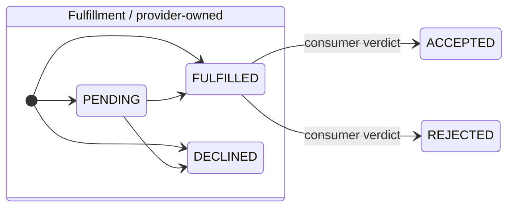
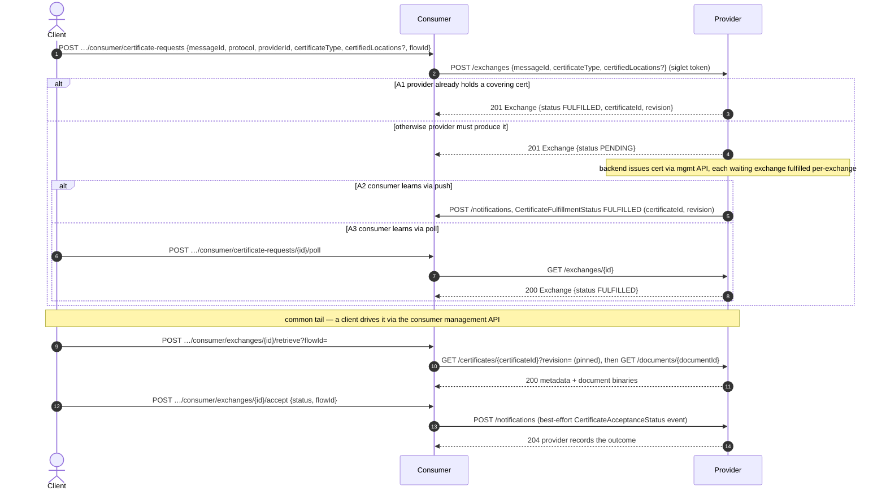
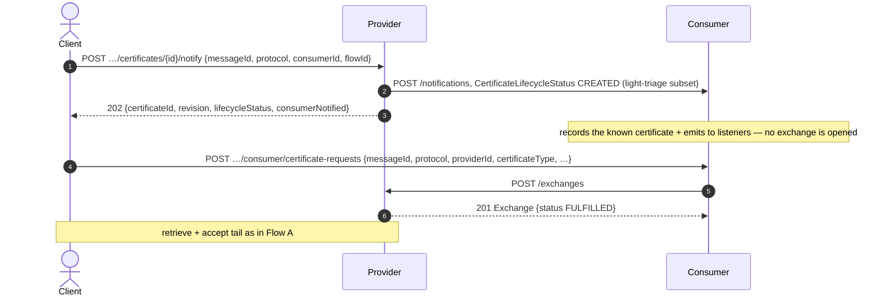
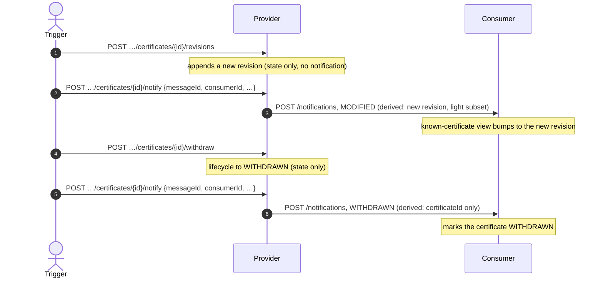
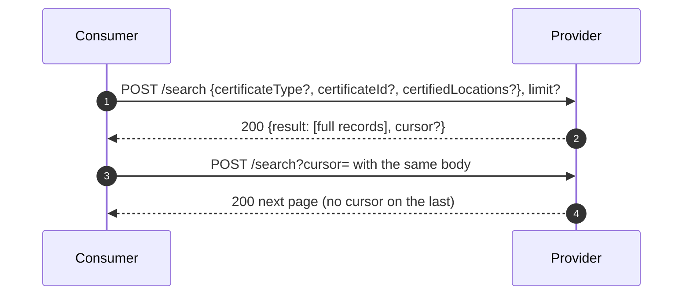

# Certo — Supported Flows

This document describes the interaction flows Certo implements. The protocol is
**[Supply Chain Certificate Exchange (SCE)](sce/certificate-exchange.md)**, implemented as a pluggable
adapter (protocol id `sce-1.0`) over a protocol-neutral core. See the
[README](../README.md) for build/run + curl examples and [`docs/sce/`](sce) for the vendored spec.

> **The consumer is a pure mechanism.** Inbound lifecycle / fulfillment events are **recorded and
> emitted** to listeners — the consumer runtime **never decides acceptance itself**. A client (an
> in-process `InboundNotificationListener`, or the optional `WebhookNotificationListener`) drives the
> consumer management API — `retrieve` (pull for inspection) then `accept` (supply the
> `ACCEPTED`/`REJECTED` verdict) — on its own timeline, carrying its live `flowId`. Every "the consumer
> accepts/rejects" below means "a client drove `accept` with that verdict."

## The model

Every flow derives from two independent state machines:

- A **Certificate Exchange** (correlated by `exchangeId`) — one delivery interaction: a provider-owned
  **Fulfillment** phase, then a consumer-owned **Acceptance** phase. Opened **only by the consumer**, by
  submitting a certificate request.
- A **Certificate Lifecycle** — the artifact over time (`CREATED → MODIFIED* → WITHDRAWN`), keyed by
  `certificateId` + `revision`, independent of any exchange. Lifecycle events are **purely
  informational**: they never open, alter, or close an exchange. A certificate is JSON metadata that
  references `documents[]` retrieved separately by opaque, revision-independent id.

> Acceptance feedback is **optional**: an exchange without it rests at `FULFILLED` indefinitely. No
> delivery receipt is modeled — delivery is a retrieval from the provider, which observes it directly.
> `DECLINED`/`ACCEPTED`/`REJECTED` are **terminal** (immutable); the grounds for a negative outcome
> travel in the status payload's `errors[]`, not in the state. A provider that can satisfy a request
> without intermediate steps reports a later state directly (e.g. `FULFILLED` when the certificate is
> already held).

> **Decoupling.** Both roles run in one process, but the provider never auto-calls the consumer (or
> vice versa) — that wiring is the control plane, which is out of scope. Each flow is driven by calling
> the relevant endpoints; cross-role calls are real OkHttp calls (through a **retrying** client) against
> the counterparty endpoint the siglet cache returns for the flow.

## Flow index

| Flow  | What                                                                                         | Variants                                                                                      |
|-------|----------------------------------------------------------------------------------------------|-------------------------------------------------------------------------------------------------|
| **A** | Consumer-initiated **request** (exchange creation)                                           | A1 held/immediate · A2 async+push · A3 async+poll · A4 declined                               |
| **B** | **Notification-initiated** flow (lifecycle notify → request)                                 | B1 accepted · B2 rejected (expired) · B3 provider **polls** the verdict                       |
| **C** | Certificate **lifecycle** (`MODIFIED` / `WITHDRAWN`)                                         | C1 revise · C2 withdraw · C3 consumer reacts                                                  |
| **D** | **Search** / discovery                                                                       | D1 by type · D2 by location filter · D3 unsupported property (400) · D4 cursor pagination     |
| **E** | **Cross-cutting** rules (state machine, envelope, batch, **idempotency**, reconciliation)    | E1–E9                                                                                         |

---

## Flow A — Consumer-initiated request

The consumer opens its **own** exchange; the certificate becomes available (immediately if held, else
asynchronously); then a client drives retrieve + accept. Driven by the management trigger
`POST /management/v1/participant-contexts/{pc}/consumer/certificate-requests` (`{pc}` = the consumer
tenant), which names the provider (`providerId`, its DID), the wire `protocol` (`sce-1.0`), and a
caller-owned `messageId` (a UUID; retries reuse it).

The `alt` boxes are **mutually-exclusive paths** — exactly one runs per request. They differ *only* in
how the consumer reaches `FULFILLED`; the client-driven retrieve + accept tail is identical.

1. **Open** — the consumer calls the provider's `POST /exchanges`; the provider assigns the
   `exchangeId` and returns `201 Created` with the `Location` and the Exchange object — **including a
   declined exchange** (`status DECLINED`, still correlatable). Creation is **idempotent on
   (counterparty, `messageId`)** (see [E5](#flow-e--cross-cutting-rules)).
2. **Become available** — a held certificate **covering every requested location filter** → `FULFILLED`
   at once; otherwise `PENDING`, and the exchange waits for the certification-authority
   backend (driven through the management API — see
   [Simplifications](#simplifications-not-protocol-limitations)). The consumer learns the outcome by
   **push** (A2) or **poll** (A3); a request the provider cannot (or will not) fulfill ends `DECLINED`
   (A4), grounds in `errors[]`. Partial coverage is never fulfilled — the provider declines instead.
3. **Retrieve (two-step, client-driven)** — `POST …/consumer/exchanges/{id}/retrieve` makes the
   consumer pull `GET /certificates/{id}?revision=` **pinned to the exchange's revision** (the
   certificate may have been modified since fulfillment) → JSON metadata listing documents by
   reference, then `GET /documents/{documentId}` for each binary. Available only once `FULFILLED`.
4. **Report acceptance (client-driven)** — `POST …/consumer/exchanges/{id}/accept {status}` records the
   client's terminal verdict and reports it to the provider (a best-effort
   `CertificateAcceptanceStatus` event on `POST /notifications`). The provider records it: unknown
   exchange → `404`, duplicate re-report → `204` without a transition, invalid transition → `409`.

**Variants**

| #      | Variant                                                                                                           |
|--------|-------------------------------------------------------------------------------------------------------------------|
| **A1** | Provider already holds a covering cert → immediate `FULFILLED` → accepted                                         |
| **A2** | Nothing held → `PENDING`; async fulfillment learned via **push** (`CertificateFulfillmentStatus`)   |
| **A3** | Same, but the consumer learns fulfillment via **poll** (`GET /exchanges/{id}`)                                    |
| **A4** | Backend declines → `DECLINED` with `errors[]` (business grounds and backend failures alike)                       |

---

## Flow B — Notification-initiated flow

The provider publishes a certificate and **notifies** a consumer with a `CREATED` lifecycle event. The
notification is **purely informational** — it opens nothing. A consumer that wants the certificate opens
an exchange by submitting a request, which the provider — already holding the certificate — fulfills
immediately; the usual retrieve + accept tail follows. The notify itself is the management trigger
`POST …/{pc}/certificates/{id}/notify`, aimed at **one named consumer** per call (Certo keeps no
counterparty registry — reaching several consumers is several notifies, each returning its own
synchronous outcome).

The event's status and revision are **derived from the certificate's current lifecycle state** — the
caller picks the target, not the content — and the caller's `messageId` becomes the pushed event's id
verbatim, so a retried notify is absorbed by the consumer's `source`+`id` dedup. The provider can pull a
consumer's verdict for any exchange instead of waiting for the acceptance push:
`POST …/{pc}/certificate-exchanges/{id}/poll-acceptance?flowId=` (the `GET /acceptance-status/{id}`
counterpart, `404`/no-verdict before the consumer decides).

**Variants**

| #      | Variant                                                                      |
|--------|--------------------------------------------------------------------------------|
| **B1** | Valid cert → notified consumer requests, retrieves, **accepts** (full loop)   |
| **B2** | Expired cert → notified consumer requests, retrieves, **rejects** ("expired") |
| **B3** | Provider **polls** the consumer's verdict (instead of the acceptance push)    |

---

## Flow C — Certificate lifecycle (MODIFIED / WITHDRAWN)

The provider changes a certificate's **state** and, as a **separate** step, notifies a named consumer,
which keeps a synchronized view. State changes tell no one; a lifecycle `notify` targets one consumer.
Lifecycle transitions never touch an exchange — a certificate may even be withdrawn while an exchange
that delivered it is non-terminal (the exchange is unaffected; the consumer may conclude it with
`REJECTED` referencing the withdrawal, or leave it at `FULFILLED`).

1. **Revise (state)** — `POST …/certificates/{id}/revisions` appends a `revision` with the caller's
   issued validity + documents (uploaded first via `POST …/{pc}/documents`); `CREATED → MODIFIED`,
   cert-level metadata carried over. No notification.
2. **Withdraw (state)** — `POST …/certificates/{id}/withdraw` sets `WITHDRAWN`:
   `GET /certificates/{id}` → `200` with the minimal `{certificateId, status: WITHDRAWN}` body, search
   excludes it, a second withdraw → `409`. No notification.
3. **Notify** — `POST …/certificates/{id}/notify` pushes the **derived** lifecycle status (`MODIFIED`
   with the light-triage subset of the latest revision; `WITHDRAWN` with the certificateId only) to one
   named consumer.
4. **Consumer reacts** — updates `GET …/{pc}/consumer/certificates/{id}`: `MODIFIED` bumps the known
   revision, `WITHDRAWN` marks it unavailable.

**Variants**

| #      | Variant                                                                              |
|--------|--------------------------------------------------------------------------------------|
| **C1** | Provider revise — the new revision is served and searchable                          |
| **C2** | Provider withdraw — `200` status body, excluded from search, a second withdraw `409` |
| **C3** | Consumer reacts to `MODIFIED` (bumps revision) / `WITHDRAWN` (marks unavailable)     |

---

## Flow D — Search / discovery

1. **Search** — the body is the SCE filter object: every supplied property narrows the result (logical
   AND), and an **empty object matches all** certificates visible to the caller. A
   `certifiedLocations` filter is a list of location filter objects (`legalEntityId`/`siteId`/
   `addressId`, at least one each); an entry matches only if it satisfies **every supplied property**,
   and a certificate matches only if **every filter object** is matched by some location. An
   unsupported filter property → `400`. Returns the latest revision of each match (`WITHDRAWN`
   excluded), without binaries. A search alone does **not** establish an exchange.
2. **Paginate** — with `limit` set, a non-final page carries an opaque `cursor` in the body; pass it
   back via the `cursor` query parameter for the next page.

**Variants**

| #      | Variant                                                   |
|--------|-------------------------------------------------------------|
| **D1** | Search by `certificateType` → latest revision             |
| **D2** | Search by location filter objects (AND semantics)         |
| **D3** | Unsupported filter property → `400`                       |
| **D4** | Cursor pagination via the body `cursor`                   |

---

## Flow E — Cross-cutting rules

Not a sequence flow — rules that apply across the others.

| #      | Rule                                    | Behavior                                                                                                                                                                                                                                                      |
|--------|-----------------------------------------|---------------------------------------------------------------------------------------------------------------------------------------------------------------------------------------------------------------------------------------------------------------|
| **E1** | **CloudEvents envelope**                | Required `specversion`=="1.0", `type`, `source`, `id` → else `400`. The optional `dataspaceidentifier` extension carries the dataspace-assigned id where one exists.                                                                                           |
| **E2** | **Sender identity**                     | An event's `source` must equal the **authenticated sender** (the verified token subject, its DID) or the event is rejected.                                                                                                                                    |
| **E3** | **Event idempotency + batch atomicity** | Duplicate `source`+`id` ignored (both sides). A batch is validated whole before any event applies — one bad event applies none. The shared `POST /notifications` serves both roles and routes by `type`; a batch must not mix the two directions.              |
| **E4** | **State machine**                       | Illegal transitions, terminal immutability, acceptance-before-`FULFILLED` → `409`; an acceptance **re-report of the current state** is a duplicate → `204`, no transition.                                                                                     |
| **E5** | **Idempotent exchange creation**        | Creation is keyed on (counterparty, `messageId`): a retry repeating the pair returns the already-created exchange — whatever state it is in, terminal included. A genuinely new request (e.g. a re-attempt after a terminal outcome) carries a new `messageId`. |
| **E6** | **Two-step retrieval, pinned**          | `GET /certificates/{id}?revision=` is JSON metadata + `documents[]` refs (latest when unpinned; an exchange-scoped retrieve pins the exchange's revision); binaries via `GET /documents/{id}` (`Content-Type = mediaType`). Records never embed content.       |
| **E7** | **Optional acceptance**                 | `FULFILLED → {ACCEPTED, REJECTED}` directly; no feedback leaves the exchange at `FULFILLED` indefinitely. No delivery receipt is modeled.                                                                                                                      |
| **E8** | **Per-location error specifier**        | `errors[]` entries may carry a `specifier` scoping the error to a certificate element (e.g. a certified-location identifier).                                                                                                                                  |
| **E9** | **Best-effort report + reconciliation** | The acceptance report is best-effort and post-commit; the exchange is marked reported **only** on confirmed delivery. Outbound HTTP **retries** a transient `5xx`; a genuinely lost report stays surfaced by `POST …/consumer/exchanges/query {"awaitingAcceptanceOnly":true}` for a re-drive, and the provider can pull the verdict (`poll-acceptance`). |

---

## Multi-tenancy

Every certificate and exchange belongs to a **participant context** (tenant: its `did` — the participant
identity used as token audience and event source — plus an optional `dataspaceIdentifier`, and a
`participantContextId`). Tenants are created via `POST /management/v1/participant-contexts` — there is no
config default, and the id never appears on the wire. The id is a server-generated UUID when omitted, or
caller-chosen when supplied (URL-safe, unique). Everything is tenant-scoped, no exceptions: an inbound
protocol call is scoped to the tenant its token **audience** (`aud` = a tenant DID) resolves to (fulfil
only from that tenant's holdings; retrieval/search never cross the boundary), and a management call names
the tenant **in the path** — every provider/consumer operation lives under
`/management/v1/participant-contexts/{participantContextId}/…` (siglet's
`/tokens/{participant_context_id}/…` convention). A resource addressed by id must belong to the path
tenant (else `404`); queries return only that tenant's resources. The only tenant-agnostic management
endpoints are the participant-context registry itself.

## Security & the consumer extension point

Security tokens on the protocol layer are **always on** and always come from a **siglet** STS
(`certo.security.siglet-base-url` is required; dev/test point at a mock siglet). The management API is
OAuth2-protected, never siglet-secured; it only carries `flowId` as data.

- **Inbound** protocol calls are verified via siglet's revocation-aware `POST /tokens/verify`. The
  subject (`sub`, the caller's **DID**) is the one identity used for all correlation — it becomes the
  exchange counterparty, and a mismatched DID cannot address another counterparty's exchange. An
  optional `dataspaceidentifier` claim carries the dataspace-assigned id. The token **audience** resolves
  to the receiving tenant.
- **Outbound** calls are made on behalf of the sender's participant context; the token **and
  counterparty endpoint** come from the siglet cache (`GET /tokens/{participantContextId}/{flowId}`), so
  the URL travels with the token (no configured-URL fallback). Outbound HTTP runs through a **retrying**
  client (Failsafe, EDC-style). `flowId` is **ephemeral** — supplied fresh on each management request
  that triggers an outbound call (`notify`, `fulfill`/`decline`, `poll-acceptance`, consumer
  `initiate`/`poll`/`retrieve`/`accept`), never persisted.
- The **wire protocol** of a counterparty is explicit everywhere: management requests name it
  (`protocol`, e.g. `sce-1.0`), inbound adapters stamp their own id on the exchanges they open, and every
  exchange records a protocol binding — there is no default, and a missing binding is a data-integrity
  error, never a fallback.

Inbound consumer notifications are **recorded, then emitted** to `InboundNotificationListener` beans (a
neutral `InboundNotification`, fire-and-forget). A plugged-in client (in-process listener, or the
`WebhookNotificationListener` when `certo.consumer.notification-callback-url` is set) drives the consumer
management API (`/consumer/exchanges/{id}/retrieve` + `/accept`) on its own timeline. After a dropped
callback or a lost acceptance report, `POST …/consumer/exchanges/query {"awaitingAcceptanceOnly":true}`
surfaces what still needs action (see [E9](#flow-e--cross-cutting-rules)). This is the consumer-side
analogue of the provider's certification-authority backend.

## Simplifications (not protocol limitations)

- The **certification-authority backend** is simulated through the management API (`documents`,
  `certificates`, `fulfill`, `decline`); a real deployment plugs its issuing system in there.
- The lifecycle **notify is single-target by design**: the spec's "push to every consumer whose endpoint
  the provider knows" obligation sits with the deploying participant — the application knows its
  counterparties and calls `notify` once per consumer; Certo keeps no registry and tracks no delivery
  state beyond the synchronous outcome of each call.

## Operational endpoints

Public, token-free (not protocol paths, so the siglet interceptor never applies): `GET /health`
(liveness — process up, dependency-free), `GET /readiness` (liveness **and** DB reachable → `200`/`503`),
and `GET /info` (descriptor).
