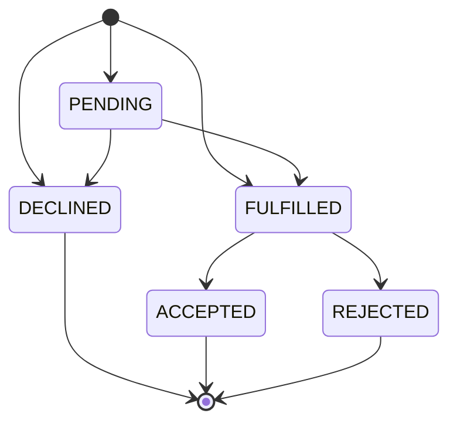
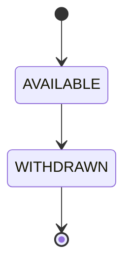
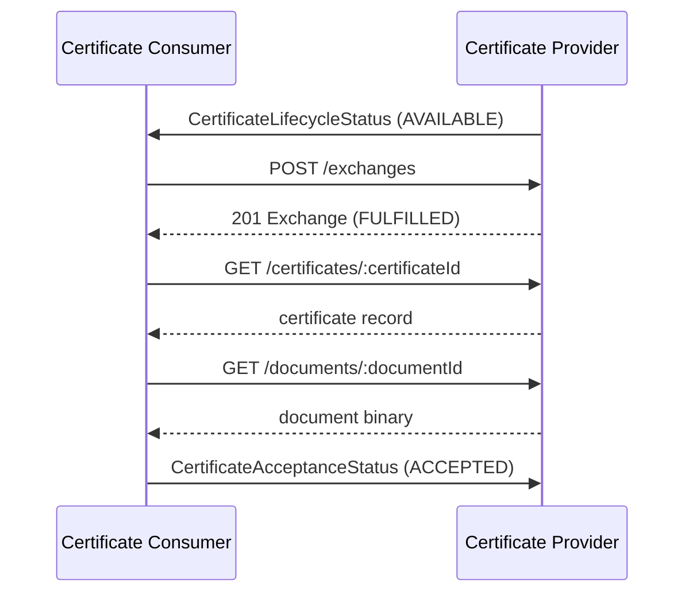
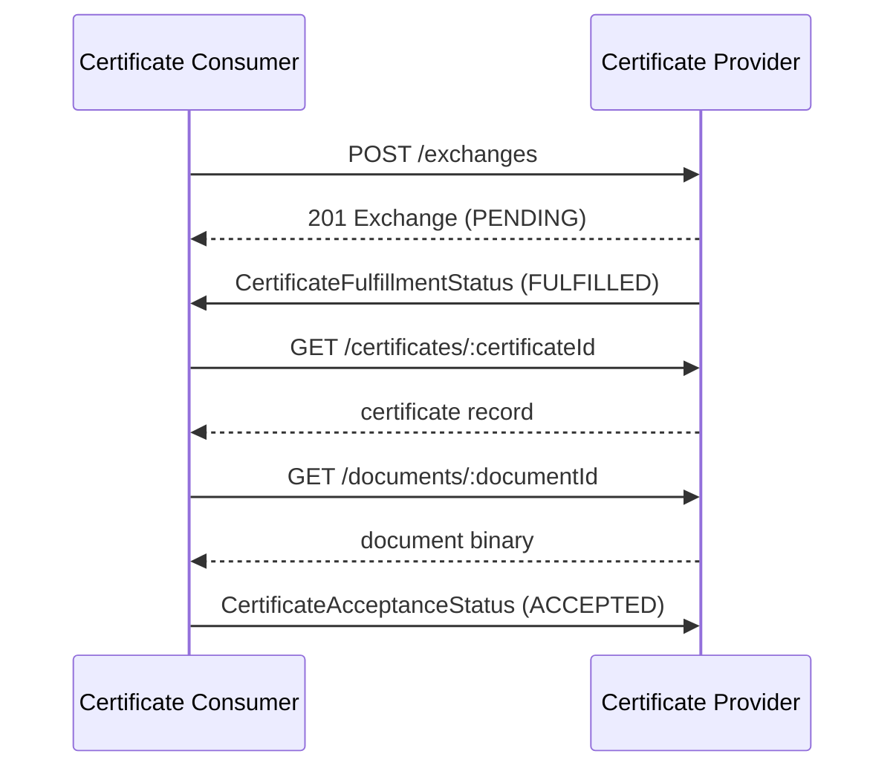

# Supply Chain Certificate Exchange

Supply Chain Certificate Exchange (SCE) defines an interoperable protocol for exchanging company certificates between
supply chain participants. It specifies the certificate exchange and certificate lifecycle state machines, the event
types that communicate their transitions, and the HTTP APIs used to request, deliver, retrieve, and search
certificates.

SCE is a [=Composing Specification=] of [Supply Chain Core Messaging](./core-messaging.md) [[sce-cm]]. All events
defined in this specification MUST conform to that specification.

## Terminology

The following terms are used to describe concepts in this specification. The terms [=Event=], [=Producer=],
[=Consumer=], and [=Participant=] are defined in [[sce-cm]].

- <dfn>Certificate</dfn>: A structured record attesting that one or more locations of a [=Participant=] hold a
  certification (for example, a quality management certification), together with the documents evidencing it.
- <dfn>Certificate Provider</dfn>: The [=Participant=] that holds and provides a [=Certificate=].
- <dfn>Certificate Consumer</dfn>: The [=Participant=] that requests, retrieves, and evaluates a [=Certificate=].
- <dfn>Certificate Exchange</dfn>: A single, correlatable interaction in which one [=Certificate=] is delivered from a
  [=Certificate Provider=] to a [=Certificate Consumer=] and its outcome is reported back.
- <dfn>Certificate Lifecycle</dfn>: The lifecycle of a [=Certificate=] as an artifact — its publication, revision, and
  withdrawal — independent of any [=Certificate Exchange=].
- <dfn>Document</dfn>: A file (typically binary, for example a PDF) evidencing a [=Certificate=] in human-readable
  form.
- <dfn>Revision</dfn>: A monotonically increasing version counter of a [=Certificate=] under a stable identifier.

## Conformance

The keywords MAY, MUST, MUST NOT, OPTIONAL, RECOMMENDED, REQUIRED, SHOULD, and SHOULD NOT in this document are to be
interpreted as described in BCP 14 [[rfc2119]] [[rfc8174]] when, and only when, they appear in all capitals, as shown
here.

A [=Participant=] MAY implement either or both of the APIs defined by this specification:

- The [Certificate Provider API](#certificate-provider-api) MUST be implemented in its entirety by a [=Participant=]
  that offers [=Certificates=].
- The [Certificate Consumer API](#certificate-consumer-api) is OPTIONAL and enables a [=Certificate Consumer=] to
  receive notifications and answer acceptance status queries.

An implementation MUST comply with the state machines, event definitions, and data model defined in this
specification.

## Base Concepts

### Certificate Exchange

A [=Certificate Exchange=] represents one end-to-end interaction between a [=Certificate Provider=] and a
[=Certificate Consumer=] involving the delivery of a single [=Certificate=], from the time the interaction is opened
until it reaches a terminal outcome.

#### Identity and Correlation

A [=Certificate Exchange=] is identified by an `exchangeId` assigned by the [=Certificate Provider=] when the exchange
is opened. The `exchangeId` is the correlation handle for the entire interaction and is distinct from the identifier
of any individual [=Event=] (`source` + `id`, see [[sce-cm]]).

An exchange concerns a specific [=Certificate=] version — a (`certificateId`, `revision`) pair — and is conducted with
a counterparty, the authenticated [=Certificate Consumer=].

A [=Certificate Exchange=] is opened only by the [=Certificate Consumer=], by submitting a certificate request (see
[Exchange Creation](#exchange-creation)). The [=Certificate Provider=] assigns the `exchangeId` and returns it in
the response. Every request opens an exchange — including one the provider declines, which opens an exchange that
terminates immediately at `DECLINED`; the `exchangeId` is still returned so the outcome remains correlatable.

Notifications never open an exchange. A certificate lifecycle event (see
[Certificate Lifecycle Events](#certificate-lifecycle-events)) is purely informational; a [=Certificate Consumer=]
that wants a correlated delivery of a [=Certificate=] it was notified about opens an exchange by submitting a
certificate request. A provider that already holds the [=Certificate=] can fulfill such a request immediately.

Each [=Certificate Exchange=] has a unique `exchangeId`. A message that repeats an `exchangeId` refers to the same
exchange rather than opening a new one. Multiple exchanges MAY concern the same [=Certificate=] and counterparty.

Acceptance feedback is correlated to the exchange by its `exchangeId`.

A re-attempt after a terminal outcome — for example, re-evaluating a `REJECTED` [=Certificate=] — is a new
[=Certificate Exchange=], with a new `exchangeId`, for the same [=Certificate=].

#### Phases and Ownership

A [=Certificate Exchange=] progresses through two sequential phases, each owned by one party:

1. **Fulfillment (provider-owned):** The [=Certificate Provider=] works to make the [=Certificate=] available.
2. **Acceptance (consumer-owned):** The [=Certificate Consumer=] retrieves and processes the [=Certificate=] and
   reports the outcome.

The phases never overlap: the Acceptance phase begins only once Fulfillment has made the [=Certificate=] available.
Provider-owned and consumer-owned states use deliberately disjoint vocabulary, so the owner of a state is unambiguous.
Each phase has one negative terminal state: `DECLINED` (the provider does not fulfill the request) and `REJECTED`
(the consumer does not accept the certificate). The grounds for a negative outcome — for example, the certificate
type is not offered, or the certificate is invalid — are carried in the status payload's `errors` array (see
[Error Object](#error-object)), not in the state. These states represent business-level outcomes only; technical and
transport failures (for example, connectivity errors or timeouts) are not modeled as [=Certificate Exchange=] states
and are handled at the transport layer.

#### Exchange State Machine

The states of a [=Certificate Exchange=] are defined below, which implementations MUST support:



| State       | Phase       | Owner    | Terminal | Description                                                                                 |
|-------------|-------------|----------|----------|-----------------------------------------------------------------------------------------------|
| `PENDING`   | Fulfillment | Provider | No       | The provider accepted the request and is working to make the certificate available.          |
| `FULFILLED` | Fulfillment | Provider | No       | The certificate is prepared and available for retrieval. Hand-off point.                     |
| `DECLINED`  | Fulfillment | Provider | Yes      | The provider did not fulfill the request; the grounds are carried in the `errors` array.     |
| `ACCEPTED`  | Acceptance  | Consumer | Yes      | The consumer accepted the certificate.                                                       |
| `REJECTED`  | Acceptance  | Consumer | Yes      | The consumer did not accept the certificate; the grounds are carried in the `errors` array.  |

The first Fulfillment status a [=Certificate Consumer=] observes is the one carried in the request response (see
[Exchange Creation](#exchange-creation)). A provider that can satisfy a request immediately MAY report
`FULFILLED` directly — the certificate is already held and `PENDING` was passed through instantly. A reported
`status` therefore reflects the exchange's current state, not necessarily a single transition from the state
before it. How a provider produces a certificate it does not yet hold (an internal process, an external
certification authority) is not modeled as exchange state; while it works, the exchange is `PENDING`.

#### Acceptance Feedback

All acceptance feedback is OPTIONAL. An exchange reaches a terminal acceptance state directly from `FULFILLED`
(`FULFILLED → {ACCEPTED, REJECTED}`). If the consumer never provides feedback, the exchange remains in
`FULFILLED` indefinitely. Note that no delivery receipt is modeled: delivery is a retrieval from the
[=Certificate Provider=], which therefore observes it directly.

#### Terminal States and Immutability

A [=Certificate Exchange=] is single-shot. The three terminal states — `DECLINED`, `ACCEPTED`, and `REJECTED` —
conclude the exchange permanently. A terminal exchange MUST NOT be reopened, reused, or transitioned further.

#### Exchange Retention

How long a party retains a [=Certificate Exchange=] — after it reaches a terminal state, or after it comes to rest at
`FULFILLED` without acceptance feedback — is defined by deployment profiles, not by this specification. After the
retention period has elapsed, [Exchange Retrieval](#exchange-retrieval) and the
[Acceptance Status Query](#acceptance-status-query) MAY respond with `HTTP 404 Not Found` for that exchange. While
retained, a terminal exchange remains immutable.

#### Relationship to the Certificate Lifecycle

A [=Certificate Exchange=] governs the *delivery* of a [=Certificate=], not the certificate itself. Modifications and
withdrawals of a certificate are changes to the certificate artifact and are not transitions of a
[=Certificate Exchange=]. A change to a certificate that has already been delivered does not reopen or alter the
(possibly terminal) exchange that delivered it.

A certificate MAY be withdrawn while an exchange that delivered it is not yet terminal. The withdrawal does not alter
the exchange; however, the certificate may no longer be retrievable (see
[Certificate Retrieval](#certificate-retrieval)). The [=Certificate Consumer=] learns of the withdrawal via the
`WITHDRAWN` lifecycle event or the withdrawal status body returned by certificate retrieval, and MAY conclude the
exchange by reporting `REJECTED` with an [error](#error-object) referencing the withdrawal; otherwise the exchange
remains at `FULFILLED`.

### Certificate Lifecycle

The [=Certificate Lifecycle=] tracks a [=Certificate=] as an artifact over time, independently of how many times it is
delivered. Whereas a [=Certificate Exchange=] is single-shot and concerns one delivery interaction, a certificate is
long-lived: it may be published, revised, and eventually withdrawn.

#### Identity and Versioning

A [=Certificate=] is identified by a `certificateId` that is stable for the life of the certificate. A modification
does not create a new identifier; instead, the certificate is versioned by a [=Revision=] counter:

- Publication makes the first `revision` of the certificate available for retrieval.
- Each subsequent publication adds a new `revision` under the same `certificateId`, superseding the previous one. The
  latest `revision` is authoritative.
- A certificate version is therefore identified by the pair (`certificateId`, `revision`). A [=Certificate Exchange=]
  delivers one specific version.

The `revision` is a positive integer with an initial value of `1` that MUST be incremented by `1` for every update of
the certificate record, including changes that do not alter the certified content (for example, a correction to the
record's metadata).

The `certificateId` and initial `revision` MAY be assigned before the certificate is published: when a
[=Certificate Provider=] accepts a request and produces the certificate later, the identifier is allocated at
acceptance so that an in-progress [=Certificate Exchange=] can reference its certificate. The certificate enters the
lifecycle (`AVAILABLE`) when it becomes available.

#### Lifecycle State Machine

The lifecycle states describe the *publication* lifecycle of the [=Certificate=], which implementations MUST support.
They are independent of the certificate's validity (see [Validity](#validity-as-a-separate-dimension)).



| State       | Terminal | Description                                                                                            |
|-------------|----------|----------------------------------------------------------------------------------------------------------|
| `AVAILABLE` | No       | The certificate is published and retrievable at its latest `revision`.                                 |
| `WITHDRAWN` | Yes      | The provider withdrew (removed) the certificate; it is no longer available. Terminal.                  |

Publishing a new `revision` is not a lifecycle transition: the certificate remains `AVAILABLE` and the `revision`
counter carries the versioning (see [Identity and Versioning](#identity-and-versioning)).

#### Validity as a Separate Dimension

A [=Certificate=]'s validity is an independent dimension derived from its `validFrom` and `validUntil` dates, not from
the publication states defined above. A given `revision` is *active* within its validity window and *expired*
afterward; this status changes with the passage of time alone — no lifecycle transition occurs. The two dimensions are
orthogonal: a certificate MAY be `WITHDRAWN` while still within its validity window, or remain `AVAILABLE`
after it has expired.

#### Relationship to the Certificate Exchange

Lifecycle state is communicated to [=Certificate Consumers=] as certificate lifecycle events (see
[Certificate Lifecycle Events](#certificate-lifecycle-events)). These events are purely informational: no lifecycle
event opens, alters, or closes a [=Certificate Exchange=]. An `AVAILABLE` reporting a new `revision` revises the
certificate in place under the same `certificateId` without initiating a new delivery, and a `WITHDRAWN` ends the
certificate's availability.

## Protocol Events

All events defined by this specification MUST conform to [[sce-cm]], including its HTTPS binding and batch rules. The
following event types are defined:

| Event Type                                     | Direction           | Purpose                                                              |
|------------------------------------------------|---------------------|----------------------------------------------------------------------|
| `org.dsaf.sce.CertificateLifecycleStatus.v1`   | Provider → Consumer | Communicates the current [=Certificate Lifecycle=] state             |
| `org.dsaf.sce.CertificateFulfillmentStatus.v1` | Provider → Consumer | Communicates the Fulfillment-phase status of a [=Certificate Exchange=] |
| `org.dsaf.sce.CertificateAcceptanceStatus.v1`  | Consumer → Provider | Communicates the Acceptance-phase status of a [=Certificate Exchange=]  |

### Certificate Lifecycle Status Event

A `CertificateLifecycleStatus` event reports the current [=Certificate Lifecycle=] state of a [=Certificate=]:
`AVAILABLE` at its latest `revision`, or `WITHDRAWN`. It is a pure notification: it MUST NOT open a
[=Certificate Exchange=] and MUST NOT carry [=Document=] content.

The `data` payload has the following structure:

|              |                                                                                                                        |
|--------------|--------------------------------------------------------------------------------------------------------------------------|
| **Schema**   | [JSON Schema](./schemas/certificate.lifecycle.status.event.schema.json)                                                   |
| **Required** | - `status`: One of `AVAILABLE`, `WITHDRAWN`.                                                                           |
|              | - `certificate`: A summary of the certificate record (see below).                                                      |

For `AVAILABLE`, the `certificate` object MUST contain exactly the following summary fields, which let a
consumer triage relevance without retrieving the certificate: `certificateId`, `revision`, `certificateType`,
`validFrom`, and `validUntil`. The provider MUST NOT include any other certificate fields — in particular not
`certifiedLocations` or `documents`.

For `WITHDRAWN`, the `certificate` object MUST contain only `certificateId`.

The `subject` attribute of the event MUST be set to the `certificateId`.

The following is a non-normative example of an `AVAILABLE` notification:

```json
{
  "specversion": "1.0",
  "type": "org.dsaf.sce.CertificateLifecycleStatus.v1",
  "source": "did:web:provider.example.com",
  "id": "a1b2c3d4-5e6f-7a8b-9c0d-1e2f3a4b5c6d",
  "subject": "550e8400-e29b-41d4-a716-446655440000",
  "time": "2026-05-04T07:00:00Z",
  "datacontenttype": "application/json",
  "data": {
    "status": "AVAILABLE",
    "certificate": {
      "certificateId": "550e8400-e29b-41d4-a716-446655440000",
      "revision": 1,
      "certificateType": "iso9001",
      "validFrom": "2026-01-25",
      "validUntil": "2029-01-24"
    }
  }
}
```

### Certificate Fulfillment Status Event

A `CertificateFulfillmentStatus` event reports the Fulfillment-phase outcome of a [=Certificate Exchange=] to the
[=Certificate Consumer=] that opened it. It never carries a certificate record.

The `subject` attribute of the event MUST be set to the `exchangeId`.

The `data` payload is the [Exchange](#exchange-object) representation, restricted to the terminal Fulfillment-phase
states:

|              |                                                                                                                            |
|--------------|------------------------------------------------------------------------------------------------------------------------------|
| **Schema**   | [JSON Schema](./schemas/certificate.fulfillment.status.event.schema.json)                                                     |
| **Required** | - `exchangeId`: The identifier of the [=Certificate Exchange=].                                                            |
|              | - `status`: One of `FULFILLED`, `DECLINED`.                                                                                 |
| **Optional** | - `certificateId`, `revision`: The certificate version the exchange concerns. MUST be present when `status` is `FULFILLED`. |
|              | - `errors`: An array of [error objects](#error-object). MUST be present and non-empty when `status` is `DECLINED`.          |

The following is a non-normative example of a `FULFILLED` notification:

```json
{
  "specversion": "1.0",
  "type": "org.dsaf.sce.CertificateFulfillmentStatus.v1",
  "source": "did:web:provider.example.com",
  "id": "f0e1d2c3-b4a5-6789-0abc-def012345678",
  "subject": "7f3a9c12-4b8e-4d6a-9e21-0c5b2a1d8f44",
  "time": "2026-05-04T07:30:00Z",
  "datacontenttype": "application/json",
  "data": {
    "exchangeId": "7f3a9c12-4b8e-4d6a-9e21-0c5b2a1d8f44",
    "certificateId": "550e8400-e29b-41d4-a716-446655440000",
    "revision": 1,
    "status": "FULFILLED"
  }
}
```

### Certificate Acceptance Status Event

A `CertificateAcceptanceStatus` event reports the Acceptance-phase status of a [=Certificate Exchange=] to the
[=Certificate Provider=]. The event is correlated to its exchange by the `exchangeId`.

The `subject` attribute of the event MUST be set to the `exchangeId`.

The `data` payload has the following structure:

|              |                                                                                                                                    |
|--------------|----------------------------------------------------------------------------------------------------------------------------------------|
| **Schema**   | [JSON Schema](./schemas/certificate.acceptance.status.event.schema.json)                                                              |
| **Required** | - `exchangeId`: The identifier of the [=Certificate Exchange=] the status applies to.                                              |
|              | - `status`: One of `ACCEPTED`, `REJECTED`.                                                                                         |
| **Optional** | - `certificateId`, `revision`: The certificate version the status applies to.                                                      |
|              | - `errors`: An array of [error objects](#error-object). MUST be present and non-empty when `status` is `REJECTED`; MUST NOT be present otherwise. |

The following is a non-normative example of a `REJECTED` acceptance status event:

```json
{
  "specversion": "1.0",
  "type": "org.dsaf.sce.CertificateAcceptanceStatus.v1",
  "source": "did:web:consumer.example.com",
  "id": "f1a2b3c4-d5e6-7f8a-9b0c-1d2e3f4a5b6c",
  "subject": "7f3a9c12-4b8e-4d6a-9e21-0c5b2a1d8f44",
  "time": "2026-05-04T09:00:00Z",
  "datacontenttype": "application/json",
  "data": {
    "exchangeId": "7f3a9c12-4b8e-4d6a-9e21-0c5b2a1d8f44",
    "certificateId": "550e8400-e29b-41d4-a716-446655440000",
    "revision": 1,
    "status": "REJECTED",
    "errors": [
      {
        "message": "Certificate has expired"
      },
      {
        "specifier": "site-0021",
        "message": "Site site-0021 was rejected"
      }
    ]
  }
}
```

### Error Object

An error object has the following structure:

|              |                                                                                                                                       |
|--------------|-------------------------------------------------------------------------------------------------------------------------------------------|
| **Schema**   | [JSON Schema](./schemas/common.schema.json) (`StatusError`)                                                                            |
| **Required** | - `message`: A human-readable description of the error.                                                                               |
| **Optional** | - `specifier`: An identifier scoping the error to a particular element of the certificate, for example a certified location identifier. If omitted, the error applies to the certificate as a whole. |

## Protocol Flows

*This section is non-normative.*

The following sequence diagrams illustrate typical [=Certificate Exchange=] interactions. HTTP requests are shown
with solid lines and their responses with dashed lines.

### Notification-Initiated Flow

The [=Certificate Provider=] publishes a new [=Certificate=] and notifies the [=Certificate Consumer=] with an
`AVAILABLE` lifecycle event. The notification is purely informational; the consumer opens a [=Certificate Exchange=] by
submitting a certificate request, which the provider — already holding the certificate — fulfills immediately in the
request response. The consumer then retrieves the certificate and reports acceptance:



### Request-Initiated Flow

The [=Certificate Consumer=] requests a [=Certificate=] the [=Certificate Provider=] does not yet hold. The provider
accepts the request (`PENDING`) and reports the Fulfillment outcome with a fulfillment status event. Once
`FULFILLED`, the consumer retrieves the certificate and reports acceptance:



A [=Certificate Consumer=] that does not expose the [Certificate Consumer API](#certificate-consumer-api) observes
Fulfillment progress by polling [Exchange Retrieval](#exchange-retrieval) instead of receiving
fulfillment status events.

## Base URL

All endpoint URLs in this specification are relative. The base URL MUST use the HTTPS scheme. The base URL is
implementation-specific and may include additional context information such as a sub-path that indicates a version.

## Certificate Consumer API

> OpenAPI specification: [certificate.consumer.api.yaml](./certificate.consumer.api.yaml)

The Certificate Consumer API enables a [=Certificate Consumer=] to receive notifications from [=Certificate
Providers=] and to answer acceptance status queries. The API is OPTIONAL; a consumer that does not wish to receive
notifications or answer acceptance status queries is not required to implement it.

A [=Certificate Consumer=] that implements the API MUST serve all specified endpoints but MAY return
`HTTP 501 Not Implemented` for endpoints it does not wish to support. For example, a consumer that wants to receive
notifications but does not want to answer acceptance status queries MAY return `HTTP 501` for the acceptance status
endpoint.

A [=Certificate Provider=] MUST push notifications as defined in this section to every [=Certificate Consumer=] whose
Consumer API endpoint it knows. This obligation applies only to the endpoints the consumer actually serves: if the
consumer returns `HTTP 501` for an endpoint, the provider is relieved of the obligation to push to that endpoint.
Polling ([Exchange Retrieval](#exchange-retrieval)) remains available as a fallback and is not a
substitute for the push obligation. How a provider discovers a consumer's endpoint is out of scope of this
specification.

### Notifications

The `notifications` endpoint accepts certificate lifecycle and fulfillment status events. The request body is a
single [=Event=] or a batch (a JSON array) as defined by [[sce-cm]].

A [=Certificate Provider=] MUST push:

- a `CertificateLifecycleStatus` event whenever a certificate the consumer is entitled to is published, revised, or
  withdrawn, reporting the resulting state (`AVAILABLE` at the latest `revision`, or `WITHDRAWN`), and
- a `CertificateFulfillmentStatus` event when an exchange opened by the consumer reaches `FULFILLED` or `DECLINED`.

A provider MAY additionally push an `AVAILABLE` event when a consumer becomes entitled to an existing certificate.

The intermediate `PENDING` state is never pushed: it is only entered when an exchange is created and is reported
synchronously in the creation response; a consumer MAY observe it at any time via the exchange status endpoint.

|                 |                                                                                                                                            |
|-----------------|--------------------------------------------------------------------------------------------------------------------------------------------|
| **HTTP Method** | `POST`                                                                                                                                     |
| **URL Path**    | `/notifications`                                                                                                                           |
| **Request**     | A [`CertificateLifecycleStatus`](#certificate-lifecycle-status-event) or [`CertificateFulfillmentStatus`](#certificate-fulfillment-status-event) event, or a batch |
| **Response**    | `HTTP 204` OR `HTTP 4xx Client Error` OR `HTTP 501`                                                                                        |

### Acceptance Status Query

The `acceptance-status` endpoint allows a [=Certificate Provider=] to query the current Acceptance-phase status of a
[=Certificate Exchange=]. It is the pull counterpart of the
[`CertificateAcceptanceStatus`](#certificate-acceptance-status-event) event and serves as a fallback and recovery
mechanism — for example, when the provider was unavailable at the time an acceptance status event was pushed. It MUST
report the same `status` as the pushed events.

If the `exchangeId` is unknown to the consumer, or the consumer has not reported an acceptance status for the
exchange, it MUST respond with `HTTP 404 Not Found`.

|                 |                                                                                                        |
|-----------------|----------------------------------------------------------------------------------------------------------|
| **HTTP Method** | `GET`                                                                                                  |
| **URL Path**    | `/acceptance-status/:exchangeId`                                                                       |
| **Response**    | `HTTP 200` with the [`CertificateAcceptanceStatus` data payload](#certificate-acceptance-status-event) OR `HTTP 4xx Client Error` OR `HTTP 501` |

## Certificate Provider API

> OpenAPI specification: [certificate.provider.api.yaml](./certificate.provider.api.yaml)

The Certificate Provider API enables [=Certificate Providers=] to accept certificate requests, report fulfillment
status, serve certificate data, answer search queries, and receive acceptance status events. A [=Certificate
Provider=] MUST implement all endpoints in this section.

### Exchange Creation

A [=Certificate Exchange=] is a resource owned by the [=Certificate Provider=]. The `exchanges` endpoint creates one.
The certificate request carried in the body identifies the certificate type sought and optionally the certified
locations the request targets.

The request body has the following structure:

|              |                                                                                                                                |
|--------------|------------------------------------------------------------------------------------------------------------------------------------|
| **Schema**   | [JSON Schema](./schemas/certificate.request.schema.json)                                                                        |
| **Required** | - `messageId`: A unique identifier for this message. MUST be a UUID [[rfc9562]].                                                |
|              | - `certificateType`: The [certificate type](#certificate-type) requested.                                                      |
| **Optional** | - `certifiedLocations`: An array of location objects the request targets. Each object MAY contain any of the properties `legalEntityId`, `siteId`, and `addressId` of a [certified location](#certified-locations), and MUST contain at least one. If the array is omitted, the request applies to the [=Certificate Provider=]'s legal entity. |

The `messageId` identifies the message, not the exchange, and makes creation idempotent: a retried request MUST reuse
the same `messageId`, and the provider MUST treat a request repeating a (counterparty, `messageId`) pair as the same
request — returning the already-created exchange rather than creating a new one. A genuinely new request MUST carry a
new `messageId`.

The requested `certifiedLocations` define a coverage obligation: the certificate delivered by the exchange MUST, for
every requested location object, contain a [certified location](#certified-locations) entry matching it, applying the
matching rules defined for the [certificate search](#certificate-search) `certifiedLocations` filter. The certificate
MAY cover additional locations beyond those requested. A [=Certificate Provider=] that cannot fulfill the request with
a covering certificate MUST `DECLINE` the exchange rather than fulfill it with partial coverage.

The response MUST be `HTTP 201 Created` with the `Location` header set to the created exchange's
[relative URL](#exchange-retrieval) and a body carrying the [Exchange](#exchange-object) representation, whose
`status` reflects the exchange's current state (see [Exchange State Machine](#exchange-state-machine)). Note that an
exchange is created even when the provider declines the request: the response is `HTTP 201` with `status` `DECLINED`.

|                 |                                                                                     |
|-----------------|---------------------------------------------------------------------------------------|
| **HTTP Method** | `POST`                                                                              |
| **URL Path**    | `/exchanges`                                                                        |
| **Request**     | The certificate request defined above                                               |
| **Response**    | `HTTP 201` with an [`Exchange`](#exchange-object) OR `HTTP 4xx Client Error`        |

The following is a non-normative example of a certificate request:

```json
{
  "messageId": "b1d5f9e2-3c4b-4f7a-9c3e-2f1e5d6c7b8a",
  "certificateType": "iso9001",
  "certifiedLocations": [
    {
      "legalEntityId": "PRT000000001234",
      "siteId": "site-0021"
    }
  ]
}
```

### Exchange Retrieval

The `exchanges` retrieval endpoint returns the current state of a [=Certificate Exchange=], covering both phases: a
[=Certificate Consumer=] polls it to observe Fulfillment progress when it missed pushed fulfillment events, and to
confirm that acceptance feedback it reported has been recorded. When the provider pushes fulfillment events, this
endpoint MUST report the same `status` as the pushed events.

If the `exchangeId` is unknown, the provider MUST respond with `HTTP 404 Not Found`.

|                 |                                                                                     |
|-----------------|---------------------------------------------------------------------------------------|
| **HTTP Method** | `GET`                                                                               |
| **URL Path**    | `/exchanges/:exchangeId`                                                            |
| **Response**    | `HTTP 200` with an [`Exchange`](#exchange-object) OR `HTTP 4xx Client Error`        |

#### Exchange Object

The Exchange object is the representation of a [=Certificate Exchange=]:

|              |                                                                                                                                |
|--------------|------------------------------------------------------------------------------------------------------------------------------------|
| **Schema**   | [JSON Schema](./schemas/exchange.schema.json)                                                                                   |
| **Required** | - `exchangeId`: The identifier assigned to the [=Certificate Exchange=].                                                       |
|              | - `status`: The exchange's current state: one of `PENDING`, `FULFILLED`, `DECLINED`, `ACCEPTED`, `REJECTED`. |
| **Optional** | - `certificateId`, `revision`: The certificate version the exchange concerns, once assigned. MUST be present when `status` is `FULFILLED`, `ACCEPTED`, or `REJECTED`. |
|              | - `errors`: An array of [error objects](#error-object). MUST be present and non-empty when `status` is `DECLINED` or `REJECTED`; for `REJECTED` it carries the errors reported by the consumer's acceptance feedback. |

The following is a non-normative example:

```json
{
  "exchangeId": "7f3a9c12-4b8e-4d6a-9e21-0c5b2a1d8f44",
  "certificateId": "550e8400-e29b-41d4-a716-446655440000",
  "revision": 1,
  "status": "FULFILLED"
}
```

### Certificate Retrieval

The `certificates` endpoint returns a certificate record conforming to the
[certificate data model](#certificate-data-model). By default the latest [=Revision=] is returned; the `revision`
query parameter selects a specific one.

When retrieving the certificate delivered by a [=Certificate Exchange=], the [=Certificate Consumer=] SHOULD pin the
retrieval to the exchange's `revision` via the `revision` query parameter: the certificate may have been modified
since the exchange was fulfilled, in which case an unpinned retrieval returns a later revision than the one the
exchange concerns.

The response includes [=Document=] references only and MUST NOT include document content. Document content is
retrieved separately (see [Document Retrieval](#document-retrieval)).

A withdrawn certificate (lifecycle state `WITHDRAWN`) need not remain retrievable: the provider MAY cease returning
the certificate record and its documents. The provider MUST, however, retain the fact that the certificate was
withdrawn and make it observable — for a withdrawn `certificateId`, the endpoint MUST return `HTTP 200` with the
minimal status body `{ "certificateId": "…", "status": "WITHDRAWN" }` (no metadata or documents). An unknown
`certificateId` returns `HTTP 404 Not Found`.

|                 |                                                                                            |
|-----------------|----------------------------------------------------------------------------------------------|
| **HTTP Method** | `GET`                                                                                      |
| **URL Path**    | `/certificates/:certificateId`                                                             |
| **Query**       | `revision` *(optional)*: a specific revision to retrieve; the latest is returned if omitted |
| **Response**    | `HTTP 200` with a [certificate record](#certificate-data-model) OR `HTTP 4xx Client Error` |

### Document Retrieval

The `documents` endpoint returns the binary content of a [=Document=] referenced by a certificate record. The
response `Content-Type` MUST be the document's `mediaType`.

|                 |                                                                       |
|-----------------|-------------------------------------------------------------------------|
| **HTTP Method** | `GET`                                                                 |
| **URL Path**    | `/documents/:documentId`                                              |
| **Response**    | `HTTP 200` with the document binary OR `HTTP 4xx Client Error`        |

### Acceptance Notifications

The `notifications` endpoint accepts [`CertificateAcceptanceStatus`](#certificate-acceptance-status-event) events by
which a [=Certificate Consumer=] reports acceptance feedback for an exchange. The request body is a single [=Event=]
or a batch (a JSON array) as defined by [[sce-cm]].

The event is correlated to its [=Certificate Exchange=] by `data.exchangeId`. An event referencing an unknown
`exchangeId` MUST be rejected with `HTTP 404 Not Found`. An event that reports the exchange's current state (a
re-report, for example after a recovery) MUST be treated as a duplicate and acknowledged with `HTTP 204` without
applying a transition. An event reporting a transition that is invalid for the exchange's current state (see
[Exchange State Machine](#exchange-state-machine)) MUST be rejected with `HTTP 409 Conflict`. An accepted event MUST
be applied to the [=Certificate Exchange=]; the resulting state is observable via
[Exchange Retrieval](#exchange-retrieval).

|                 |                                                                                                  |
|-----------------|----------------------------------------------------------------------------------------------------|
| **HTTP Method** | `POST`                                                                                           |
| **URL Path**    | `/notifications`                                                                                 |
| **Request**     | A [`CertificateAcceptanceStatus`](#certificate-acceptance-status-event) event, or a batch        |
| **Response**    | `HTTP 204` OR `HTTP 4xx Client Error`                                                            |

### Certificate Search

The `search` endpoint returns certificate records matching the supplied criteria. The request body is a single JSON
object whose properties are filters; a certificate matches only if it satisfies every supplied filter (logical AND).
An empty object matches all certificates visible to the caller.

The following filters MUST be supported:

|              |                                                                                                                                     |
|--------------|-----------------------------------------------------------------------------------------------------------------------------------------|
| **Schema**   | [JSON Schema](./schemas/certificate.search.request.schema.json) (response: [JSON Schema](./schemas/certificate.search.response.schema.json)) |
| **Optional** | - `certificateId`: Matches the certificate with this identifier.                                                                    |
|              | - `certificateType`: Matches certificates of this [certificate type](#certificate-type).                                            |
|              | - `certifiedLocations`: An array of location filter objects (see below).                                                            |

A location filter object MAY contain any of the properties `legalEntityId`, `siteId`, and `addressId`, and MUST
contain at least one. A [certified location](#certified-locations) entry matches a location filter object only if it
satisfies every property the object supplies (logical AND, compared for equality). A certificate matches the
`certifiedLocations` filter only if, for every location filter object, at least one of its certified location entries
matches that object (logical AND across the array).

A provider MAY support additional filter properties. A search using a filter property the provider does not support
MUST be rejected with `HTTP 400 Bad Request`.

Each result entry carries the full certificate metadata for the latest [=Revision=], conforming to the
[certificate data model](#certificate-data-model), without document content.

Results MAY be paginated. The `limit` query parameter bounds the page size. When a response is not the last page, it
MUST carry a non-empty `cursor` property; the client passes the value back via the `cursor` query parameter to fetch
the next page. The `cursor` value is opaque to the client.

|                 |                                                                                                       |
|-----------------|---------------------------------------------------------------------------------------------------------|
| **HTTP Method** | `POST`                                                                                                |
| **URL Path**    | `/search`                                                                                             |
| **Query**       | `limit` *(optional)*: maximum number of results per page; `cursor` *(optional)*: opaque page cursor   |
| **Request**     | The filter object defined above                                                                       |
| **Response**    | `HTTP 200` with `{ "result": [ … ], "cursor": "…" }` OR `HTTP 4xx Client Error`                       |

The following is a non-normative example of a search request and response:

```json
{
  "certificateType": "iso14001",
  "certifiedLocations": [
    {
      "legalEntityId": "PRT000000001234",
      "siteId": "site-0021"
    }
  ]
}
```

```json
{
  "result": [
    {
      "certificateId": "550e8400-e29b-41d4-a716-446655440000",
      "revision": 1,
      "certificateType": "iso14001",
      "certificateTypeVersion": "2015",
      "registrationNumber": "12 100 4711",
      "validFrom": "2026-01-25",
      "validUntil": "2029-01-24",
      "certifiedLocations": [
        {
          "legalEntityId": "PRT000000001234",
          "siteId": "site-0021",
          "locationRole": "MAIN_LOCATION"
        }
      ],
      "issuer": {
        "issuerName": "Example Certification Body",
        "issuerId": "PRT000000009876"
      },
      "documents": [
        {
          "documentId": "3fa85f64-5717-4562-b3fc-2c963f66afa6",
          "createdDate": "2026-01-25",
          "language": "en",
          "mediaType": "application/pdf"
        }
      ]
    }
  ]
}
```

## Certificate Data Model

A certificate record exchanged under this specification MUST conform to the following data model.

### Certificate Record

|              |                                                                                                                        |
|--------------|----------------------------------------------------------------------------------------------------------------------------|
| **Schema**   | [JSON Schema](./schemas/certificate.schema.json)                                                                       |
| **Required** | - `certificateId`: Unique identifier of the certificate. MUST be a UUID [[rfc9562]].                                   |
|              | - `revision`: Positive integer identifying the certificate version (see [Identity and Versioning](#identity-and-versioning)). |
|              | - `certificateType`: The [certificate type](#certificate-type).                                                        |
|              | - `validFrom`: Inclusive validity start date.                                                                          |
|              | - `validUntil`: Inclusive validity end date.                                                                           |
|              | - `certifiedLocations`: An array of [certified location](#certified-locations) entries.                                |
|              | - `issuer`: The issuing party: `issuerName` (required) and `issuerId`, its [=Participant=] or dataspace identifier (optional). |
|              | - `documents`: An array of [document references](#documents).                                                          |
| **Optional** | - `certificateTypeVersion`: Edition of the certificate type (for example, `2015`).                                     |
|              | - `registrationNumber`: The issuing authority's registration number for the certificate.                               |
|              | - `areaOfApplication`: The overall scope statement of the certificate, verbatim, when not scoped per location.         |
|              | - `validator`: The validating party, when distinct from the issuer: `validatorName` (required) and `validatorId` (optional). |

### Certificate Type

The `certificateType` is an opaque string code identifying the type of certification (for example, `iso9001`,
`iso14001`, `iatf16949`). Type codes MUST follow these spelling rules:

1. Only Latin letters and digits are allowed.
2. All letters are lowercase.
3. No whitespace, underscores, or other special characters are allowed.

The set of certificate types is open; deployments define which types they support.

### Certified Locations

Each entry of `certifiedLocations` represents exactly one certified location as stated on the certificate document.
An entry has the following structure:

|              |                                                                                                                            |
|--------------|--------------------------------------------------------------------------------------------------------------------------------|
| **Required** | - `legalEntityId`: Identifier of the legal entity the location belongs to. For the `MAIN_LOCATION` entry this is also the certificate holder. |
|              | - `locationRole`: One of `MAIN_LOCATION`, `ENCLOSED_LOCATION`, `REMOTE_SUPPORT_LOCATION`, `EXTENDED_MANUFACTURING_SITE`.  |
| **Optional** | - `siteId`: Identifier of the certified site, when applicable.                                                             |
|              | - `addressId`: Identifier of the certified address, when applicable.                                                       |
|              | - `areaOfApplication`: Location-specific scope, verbatim, only if explicitly stated on the certificate or its annex.       |

Location identifiers are dataspace-scoped identifiers; their format is defined by the deployment context.

The following rules apply:

1. Exactly one entry MUST have `locationRole` = `MAIN_LOCATION`.
2. The certificate holder is derived as the `legalEntityId` of the `MAIN_LOCATION` entry.
3. A per-location `areaOfApplication` MUST be set only if a location-specific scope is explicitly stated on the
   certificate or its annex; otherwise it MUST be absent. Every printed scope statement MUST appear exactly once in
   the record.
4. Interpretation logic (scope inheritance to subordinate locations, hierarchy expansion) is out of scope of this
   specification and left to the [=Certificate Consumer=].

### Documents

Each entry of `documents` is a reference to a [=Document=] and MUST NOT carry document content. An entry has the
following structure:

|              |                                                                                                          |
|--------------|--------------------------------------------------------------------------------------------------------------|
| **Required** | - `documentId`: Unique, revision-independent identifier of the document, resolvable via [Document Retrieval](#document-retrieval). It is RECOMMENDED to use a UUID. |
|              | - `mediaType`: Media type of the document binary (for example, `application/pdf`) [[rfc2046]].           |
| **Optional** | - `createdDate`: Date the document was created.                                                          |
|              | - `language`: Primary language of the document as an [[iso639-1]] two-letter code (for example, `en`).   |

Multiple documents support certificates that consist of several files, for example different language versions.

## Security and Authorization

All endpoints MUST use HTTPS, that is, HTTP over TLS 1.2 or higher. Authorization mechanisms, including token formats
and acquisition, are defined by deployment profiles of this specification, consistent with [[sce-cm]].

**Sender identity.** Every event carries the asserting party's identity in its `source` attribute (see [[sce-cm]]).
The recipient MUST verify that `source` matches the authenticated identity of the sender and MUST reject the event
when they do not match:

- A [=Certificate Consumer=] MUST reject a lifecycle or fulfillment status event whose `source` does not match the
  authenticated [=Certificate Provider=].
- A [=Certificate Provider=] MUST reject an acceptance status event whose `source` does not match the authenticated
  [=Certificate Consumer=] of the referenced exchange.

**Document confidentiality.** [=Certificates=] and [=Documents=] are confidential. Certificate records and document
binaries MUST be served only over the authenticated channel and only to counterparties authorized for them.

If a client is not authorized for an endpoint request, the endpoint MUST return `401 Unauthorized` or
`404 Not Found`.

## Dataspace Protocol Integration

This section defines how the APIs specified by this document are offered in dataspaces based on the Dataspace
Protocol [[dsp]]. It applies to deployments that publish the APIs through [[dsp]] catalogs.

### Dataset Definitions

Each API is offered as a [[dsp]] dataset. A dataset offering an API defined by this specification MUST carry exactly
one of the following `dct:conformsTo` values, which identifies both the API and the specification major version:

| Conformance URI                                | API                                                    |
|------------------------------------------------|----------------------------------------------------------|
| `https://w3id.org/dsaf/sce/v1/provider-api`    | [Certificate Provider API](#certificate-provider-api) |
| `https://w3id.org/dsaf/sce/v1/consumer-api`    | [Certificate Consumer API](#certificate-consumer-api) |

A [=Certificate Provider=] publishes a dataset conforming to `provider-api`. A [=Certificate Consumer=] that
implements the [Certificate Consumer API](#certificate-consumer-api) publishes a dataset conforming to
`consumer-api` — in [[dsp]] terms the consumer is the provider of that dataset, and a [=Certificate Provider=]
obtains access to the consumer's endpoint by negotiating it. Publishing a `consumer-api` dataset declares that the
participant receives notifications; a participant that does not wish to receive notifications does not publish one.
Per-endpoint opt-out remains `HTTP 501` as defined in [Notifications](#notifications).

A participant SHOULD publish one dataset per API.

A dataset's distribution MUST use the HTTP Transfer Profile defined by Data Plane Signaling [[dps-http]] as its
`dct:format` (pull direction).

### Identity Binding

An agreement on a dataset is bound to the counterparty's verified identity — the same identity that appears in an
event's `source` attribute and is verified per [Security and Authorization](#security-and-authorization). A
[=Certificate Provider=]'s notification obligations (see [Notifications](#notifications)) extend to each
[=Certificate Consumer=] whose `consumer-api` dataset it holds an agreement on.

### Examples

The following is a non-normative example of a `provider-api` dataset:

```json
{
  "@type": "dcat:Dataset",
  "@id": "urn:uuid:3dd1b1e2-8b3e-4f2a-9c7d-1a2b3c4d5e6f",
  "dct:conformsTo": { "@id": "https://w3id.org/dsaf/sce/v1/provider-api" },
  "odrl:hasPolicy": [ { "...": "..." } ],
  "dcat:distribution": [{
    "@type": "dcat:Distribution",
    "dct:format": { "@id": "https://w3id.org/dspace-sig/profile/http-pull" },
    "dcat:accessService": { "@id": "urn:uuid:9afb64c1-2d7e-4b8a-8f3c-5d6e7f8a9b0c" }
  }]
}
```

The following is a non-normative example of a `consumer-api` dataset:

```json
{
  "@type": "dcat:Dataset",
  "@id": "urn:uuid:77c2a9d4-6e1f-4c3b-b8a5-2f3e4d5c6b7a",
  "dct:conformsTo": { "@id": "https://w3id.org/dsaf/sce/v1/consumer-api" },
  "odrl:hasPolicy": [ { "...": "..." } ],
  "dcat:distribution": [{
    "@type": "dcat:Distribution",
    "dct:format": { "@id": "https://w3id.org/dspace-sig/profile/http-pull" },
    "dcat:accessService": { "@id": "urn:uuid:c04e5f6a-7b8c-4d9e-a0f1-3b4c5d6e7f8a" }
  }]
}
```

## References

*Note: when this document is converted to ReSpec, inline `[[citation]]` references will be resolved automatically via
SpecRef, and this section will be generated.*

### Normative References

<a id="dsp"></a>
**[dsp]** Eclipse Dataspace Working Group, "Dataspace Protocol 2025-1",
<https://eclipse-dataspace-protocol-base.github.io/DataspaceProtocol/2025-1/>.

<a id="dps-http"></a>
**[dps-http]** Eclipse Data Plane Signaling, "HTTP Transfer Profile", <https://w3id.org/dspace-sig/profile/http>.

<a id="sce-cm"></a>
**[sce-cm]** "Supply Chain Core Messaging", [core-messaging.md](./core-messaging.md).

<a id="iso639-1"></a>
**[iso639-1]** International Organization for Standardization, "ISO 639-1:2002, Codes for the representation of names
of languages — Part 1: Alpha-2 code", <https://www.iso.org/standard/22109.html>.

<a id="rfc2046"></a>
**[rfc2046]** Freed, N. and Borenstein, N., "Multipurpose Internet Mail Extensions (MIME) Part Two: Media Types",
RFC 2046, November 1996, <https://www.rfc-editor.org/rfc/rfc2046>.

<a id="rfc2119"></a>
**[rfc2119]** Bradner, S., "Key words for use in RFCs to Indicate Requirement Levels", BCP 14, RFC 2119, March 1997,
<https://www.rfc-editor.org/rfc/rfc2119>.

<a id="rfc8174"></a>
**[rfc8174]** Leiba, B., "Ambiguity of Uppercase vs Lowercase in RFC 2119 Key Words", BCP 14, RFC 8174, May 2017,
<https://www.rfc-editor.org/rfc/rfc8174>.

<a id="rfc9562"></a>
**[rfc9562]** Davis, K., Peabody, B., and Leach, P., "Universally Unique IDentifiers (UUIDs)", RFC 9562, May 2024,
<https://www.rfc-editor.org/rfc/rfc9562>.
